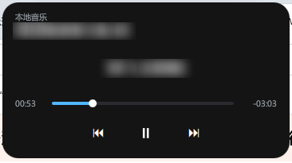
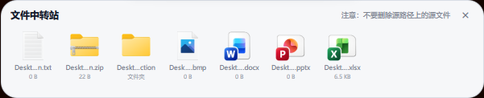
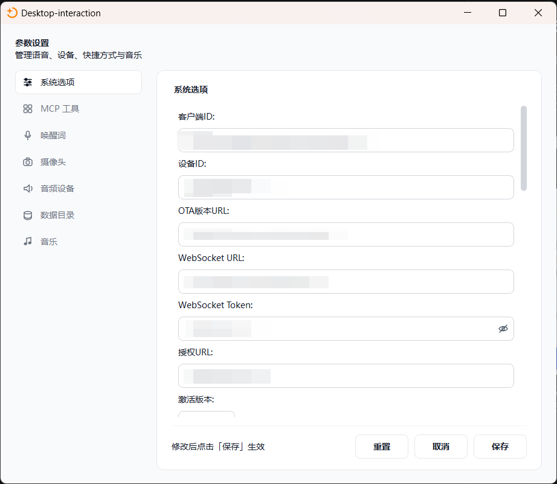

#  Desktop-interaction

> 桌面助手 | Desktop-interaction

  
  
  
  
  

  一个更贴合windows桌面使用习惯的小智语音客户端 ✨ 
  悬浮胶囊 · 音乐播放 · 歌词显示 · TTS 与音乐共存 · 文件中转站

---

## 📖 项目简介

**Desktop-interaction** 是一个使用 Python 实现的桌面端小智语音客户端。本项目基于开源项目 [py-xiaozhi](https://github.com/huangjunsen0406/py-xiaozhi) 进行二次开发，主要针对 **桌面端交互体验、UI操作界面、音乐播放体验、本地操作逻辑和文件中转等** 做了优化和部分功能新增。

原版 `py-xiaozhi` 已经提供了完整的小智语音客户端能力，包括语音对话、TTS 播报、MCP 工具、音乐播放、日程、摄像头识别等功能。本项目在此基础上，更偏向 **“桌面常驻助手”** 的使用体验，希望让它在日常电脑使用中更加自然、便捷、少打扰。

一个属于你的桌面 AI 助手，可以让其播放音乐、打开软件、进行智能问答、屏幕截图问答等；定位 Windows 系统桌面辅助型人工智能工具。

📁 目录结构与日志等级说明见 [PROJECT_STRUCTURE.md](PROJECT_STRUCTURE.md)。

⛏️ 项目开发及开发环境运行说明见 [PROJECT_DEVELOPMENT.md](PROJECT_DEVELOPMENT.md)

👤 食用方法参考 [USER_MANUAL.md](USER_MANUAL.md)

---

## 🔗 项目地基

本项目基于以下开源项目开发：

| 类型 | 项目 | 说明 |
| :--- | :--- | :--- |
| 原项目 | [`py-xiaozhi`](https://github.com/huangjunsen0406/py-xiaozhi) | 基础项目 |
| 上游项目 | [`xiaozhi-esp32`](https://github.com/78/xiaozhi-esp32) | 相关上游 |

🙏 感谢原作者和社区提供的基础项目。

---

## 🚀 主体内容

### 1️⃣ 胶囊式交互界面

- 重做桌面交互界面，做悬浮胶囊界面更灵动
- 使用黑色胶囊风格减少常驻窗口对桌面操作的干扰
- 支持输入窗口悬浮展开状态、不使用时点击屏幕外或者按“ESC”可退出并隐藏。
- 优化 TTS播报、聆听状态、输入框的显示方式
- 点击“白条”可以弹出输入框，即使因环境无法说话也能交互
- 新增可自动打开网页、网站
- 设计目标是：你几乎感觉不到它在那里，但需要的时候一叫就出来

### 2️⃣ 音乐界面隐藏及历史对话显示

- 增加了在音乐播放状态可以触发“显示/收起歌词”快捷键可以收起/显示歌词界面
- 增加右键“白条”显示历史及现在文本窗口，让历史可见
- 文本输入更轻便，不打扰：输入框显示在屏幕正上方，通过点击处于“白条”状态触发或者快捷键触发

### 3️⃣ 本地音乐及在线音乐播放优化
- 添加本地音乐播放选择，可以播放选择的音乐文件内音乐，
-  TTS 播报时不再粗暴中断本地音乐播放，会降低音乐播放声音，让位给tts语言播报，
-  对话时使用 ducking 方式降低本地音乐播放的音量，TTS 结束后恢复本地音乐播放的音量。

（音乐播放界面默认在屏幕正上方-此图片为展开的音乐控制界面）

### 4️⃣ 文件中转站

  

（文件中转站界面默认在屏幕正上方）

-  可以把日常频繁移动、复制的文件 / 文件夹放置到中转站
-  不需要频繁切换窗口也可以实现文件位置交换
-  适合桌面文件整理、批量移动、多窗口操作场景

---

## ✨ 新功能特性介绍

- 支持歌词显示与隐藏；
- 支持桌面胶囊界面交互；
- 支持文件中转站，减少窗口切换文件移动；（注意：中转站是桌面临时存放文件路径的窗口，用来实现跨窗口移动/复制文件，不是跨平台传输中转站）
- 文字输入加强 / 输入框单独显示；
- 支持打开网站 / 不再只打开浏览器让用户手动输入网址；
- 添加本地音乐随机播放器工具，支持自动随机播放本地音乐库音乐；
- 添加本地文件操作工具，可以让ai操作指定电脑区域内的文件
- 学习了上游项目(<a href="https://github.com/huangjunsen0406/py-xiaozhi">py-xiaozhi</a>)重新设计了ui界面

## 🎯 项目定位

本项目更偏向于：

-  **桌面常驻 AI 助手**
-  **桌面交互工具**
-  适合希望在 PC 上体验小智语音交互、MCP 工具和桌面浮窗交互的用户
-  定位 Windows 电脑桌面辅助人工智能

如果你想要的是一个功能大而全、界面复杂的桌面 AI 客户端，它可能不是最合适的选择。  
但如果你想要的是一颗安静待在桌面角落、叫它才出来、用完就消失的语音助手，它的设计思路会非常对味。

---

## 📦 发布说明

如果你从本项目继续修改或分发，请注意：

- ✅ 再分发时，请保留原始版权声明和 MIT 许可证文本。原项目许可证见 [LICENSE-py-xiaozhi](LICENSE-py-xiaozhi)。
- ✅ 保留本项目版权声明
- ✅ 明确说明项目来源于 `py-xiaozhi`和`Desktop-interaction`
- ⚠️ 注意：不要将本项目表述为 `py-xiaozhi` 官方版本

---

## 📄 许可协议

本项目基于 [py-xiaozhi](https://github.com/huangjunsen0406/py-xiaozhi) 进行开发。

原项目采用 **MIT License** 许可证，原始版权归原作者所有

本项目新增和修改的代码同样按 **MIT License** 发布，除非特别说明。

- 本项目主许可证：[LICENSE](LICENSE)
- 原项目许可证副本：[LICENSE-py-xiaozhi](LICENSE-py-xiaozhi)

This project is licensed under the MIT License. See [LICENSE](LICENSE) for details.

This project is a modified version of [py-xiaozhi](https://github.com/huangjunsen0406/py-xiaozhi). The original MIT License is preserved in [LICENSE-py-xiaozhi](LICENSE-py-xiaozhi).

Original copyright (c) 2025 Junsen.  
Modifications copyright (c) 2026 LvedByLove.

请在使用、修改、分发本项目时保留原始版权声明和许可证文件。

---

## 🙏 致谢

感谢以下项目和作者：

- [py-xiaozhi](https://github.com/huangjunsen0406/py-xiaozhi)
- [xiaozhi-esp32](https://github.com/78/xiaozhi-esp32)
- py-xiaozhi 原作者及贡献者
- 小智开源社区

---

## ⚠️ 免责声明

本项目为个人学习和体验优化用途的 **非官方二次开发版本**。项目中涉及的小智服务、协议、第三方接口、音乐服务等能力，请遵守对应服务提供方的使用条款所说明的使用要求。若上游项目、接口服务或相关权利方对项目说明、署名方式或分发方式有异议，请联系后进行调整。

---

  Made with ❤️ for the 小智 community

