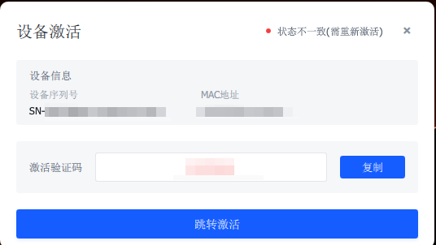
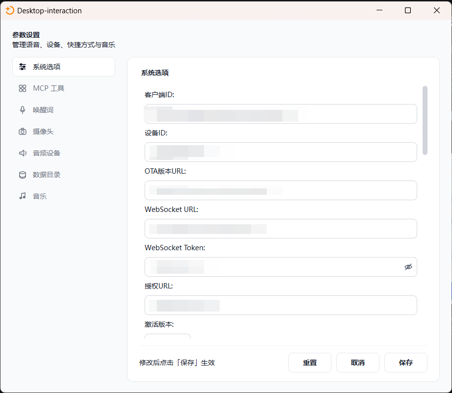
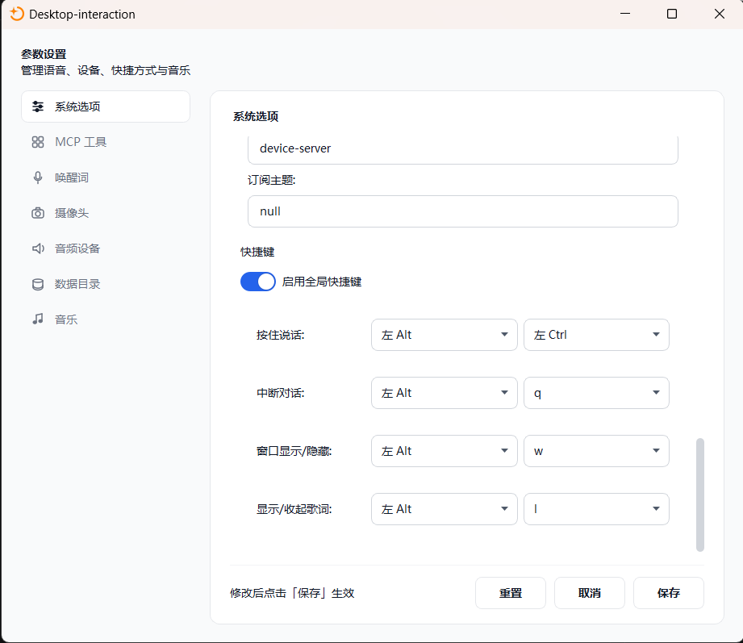
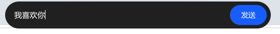
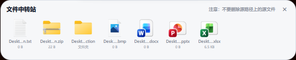

# 💻运行方式（二选一）

A- 直接下载releases已经打包好的最新安装包运行安装

B- 源码运行main.py，具体参考项目开发及开发环境运行说明见 [PROJECT_DEVELOPMENT.md](PROJECT_DEVELOPMENT.md)

---

# 🪄使用说明

1.第一次启动程序会弹出激活界面，根据指导前往小智官方服务器激活

---

2.激活完成后系统托盘会有一个Desktop-interaction图标的图标，鼠标右键点击可以看到**设置/退出**

---

3.设置页可以设置程序的自启动、唤醒词、数据存储目录、音乐设置等

---

4.**系统选项**最底部有快捷键操作设置，按照自己习惯设置快捷键

## 快捷键使用
🎤**按住说话**——是按住这个快捷方式不松手可以进行与小智对话交流问答

---“帮我播放XX音乐”

---“帮我打开微信/qq等程序”

---“明天的天气怎么样"

🔕**中断对话**——顾名思义就是打断正在进行的对话，在小智说话时按[按住说话]快捷键也可以打断说话

🔤**窗口显示/隐藏**——是输入框的窗口隐藏及显示，当当前环境嘈杂或者不适合语言时可以通过输入框进行简短对话

输入框默认居中在屏幕正上方

🎵**显示/收起歌词**——既在播放音乐时会有单独的音乐播放界面，如果界面遮挡桌面操作可以通过快捷键隐藏

---

## 文件中转站

文件中转站在屏幕正上方显示，通过选中文件/文件夹拖动到顶部触发，为了防止文件。文件夹数量太多，默认限制每次拖入不超过50个文件，总文件数不超过80个